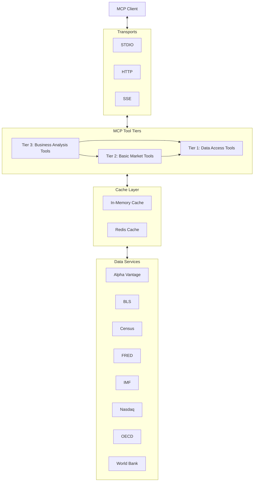

# Market Sizing MCP Server

[](https://github.com/gvaibhav/TAM-MCP-Server/blob/main/LICENSE)
[](https://www.typescriptlang.org/)
[](https://github.com/modelcontextprotocol/typescript-sdk)

A Model Context Protocol server exposing 28 tools, 15 business prompts, static resources, and economic/financial data adapters. Public-source observations are available where provider access succeeds; catalog-backed market sizing features fail explicitly until an authoritative catalog is configured.

## Verification status (2026-10-16)

| Area | Verified | Still needs verification or implementation |
|---|---|---|
| Build and automated tests | Node.js 22 Docker build; 232 tests in 21 files pass | The default suite uses mocks and includes placeholder end-to-end tests; it does not exercise every tool against a live provider |
| MCP transport | Docker `/health` returned 200; Streamable HTTP negotiated `2025-11-25`; listing returned 28 tools, 15 prompts, and 9 resources; an SDK client verified initialization guidance, tool status pointers, and all three status-resource reads | Real-client notification delivery, legacy SSE behavior, every tool call, and MCP `2026-07-28` compatibility |
| Public and free-tier providers | Direct live API probes returned data from World Bank, FRED, Finnhub, CoinGecko, and the public ExchangeRate endpoint | These probes do not establish that every MCP tool using those providers works or that cached data is current |
| Limited or failing providers | OECD was reachable but its dataset query/parser needs work; BLS and Census rejected the configured values; Alpha Vantage `OVERVIEW` returned a tier restriction; Nasdaq Data Link was blocked; the IMF adapter uses an obsolete endpoint | A valid key, eligible endpoint or subscription, adapter update, and an end-to-end tool call as applicable |
| Premium market data | No licensed industry catalog or paid-provider response has been verified | IBISWorld, Statista, Grand View Research, Bloomberg, and PitchBook have placeholder key names only; no adapters or paid subscriptions are configured. Nasdaq paid datasets and Alpha Vantage paid endpoints are untested |

These are results from the stated date, not an ongoing availability guarantee. A passing mock test or a successful direct API probe is not proof of live MCP tool correctness. See [provider-by-provider evidence](DATA_SOURCE_STATUS.md), [API key requirements](API_KEY_SETUP.md), and [remaining work](AUDIT_AND_UPGRADE_PLAN.md).

### How a connected agent discovers this state

The MCP `initialize` response includes `instructions` directing the client to read three resources: `tam://data-source-status` for provider results and untested premium sources, `tam://mcp-status` for feature/test limits, and `tam://api-key-setup` for credential setup. Every tool description also points to provider status and explains that key presence does not prove live access. Clients can discover these with `resources/list` and retrieve them with `resources/read`.

The host controls whether these instructions and resources reach its model. If it only exposes tools, it must enable resource reads or supply the status documents as context. These documents are dated snapshots, not a live health feed; inspect each tool's `isError`, provenance, observation date, and cache behavior. Initialization instructions are part of the [MCP lifecycle](https://modelcontextprotocol.io/specification/2025-11-25/basic/lifecycle), and resource inclusion is [controlled by the host](https://modelcontextprotocol.io/specification/2025-11-25/server/resources).

For agents editing this repository, [AGENTS.md](AGENTS.md) captures project rules and links to [verification](.agents/skills/tam-mcp-verify/SKILL.md), [provider integration](.agents/skills/tam-mcp-provider/SKILL.md), and [runtime upgrade](.agents/skills/tam-mcp-upgrade/SKILL.md) skills. Those local files are not sent to remote MCP clients.

*Previously featured in the official MCP community servers list here : https://github.com/modelcontextprotocol/servers/blob/e21dbea731f2ccddcd48525cf9a1e1e405fee12f/README.md*

## Overview

This MCP server provides comprehensive market research capabilities including:

- **28 Tools**: Market analysis, data access, and business intelligence tools
- **15 Prompts**: Professional business analysis templates for funding, strategy, and research
- **Data Integration**: World Bank, FRED, Census, BLS, OECD, IMF, Alpha Vantage, Finnhub, Nasdaq Data Link, CoinGecko, and ExchangeRateAPI, with provider-specific availability
- **Tool defaults**: Some tools provide sample parameters; source access and catalog-backed operations still require valid data and a defined methodology
- **Multiple Transports**: STDIO, Streamable HTTP, and SSE support

### Architecture Overview



### Capabilities

**Market Analysis Tools**
- Input-based Total Addressable Market (TAM) and Serviceable Addressable Market (SAM) calculations
- Source-backed market size estimation and forecasting interfaces (currently unavailable without an authoritative catalog)
- Industry, segmentation, and opportunity interfaces (catalog-backed results are currently unavailable)
- Data validation interfaces (live cross-source accuracy is not yet verified)

**Business Intelligence Prompts**
- Startup funding pitch preparation
- Private equity investment analysis
- Corporate strategy and market entry
- Crisis management and regulatory impact assessment
- ESG and sustainability analysis

**Data Access**
- Real-time financial and economic data retrieval
- Provider-specific data access with explicit errors when a source is unavailable
- In-memory caching for adapters that opt into the cache layer

**MCP Protocol Features**
- **Notifications**: Standard MCP progress/logging notifications plus documented TAM-specific extension notifications
- **Multiple Transports**: STDIO and Streamable HTTP; legacy SSE is retained for compatibility
- **Resource Access**: Documentation and status information available through MCP resources
- **Tool Discovery**: Complete tool catalog with smart defaults and validation

## Installation

### Prerequisites
- Node.js 20.x or later; Docker uses Node.js 22
- npm or yarn
- API keys for data sources (optional, see Configuration)

### Quick Setup

```bash
# Clone repository
git clone https://github.com/your-username/TAM-MCP-Server.git
cd TAM-MCP-Server

# Install dependencies
npm install

# Configure environment
cp .env.example .env
# Edit .env with your API keys

# Build and start (HTTP - recommended)
npm run build
npm run start:http
```

### Development Setup

```bash
# Use development script
chmod +x scripts/dev-setup.sh
./scripts/dev-setup.sh

# Or manual setup
npm install
npm run build
npm run start  # HTTP server
npm run start:stdio  # STDIO transport
```

### Docker Deployment

```bash
# Build image
docker build -t tam-mcp-server .

# Run container with environment file
docker run -p 3000:3000 --env-file .env tam-mcp-server

# Or run with individual environment variables
docker run -p 3000:3000 \
  -e ALPHA_VANTAGE_API_KEY=your_key_here \
  -e FRED_API_KEY=your_key_here \
  -e NODE_ENV=production \
  tam-mcp-server
```

### MCP Integration

**HTTP Transport (Recommended)**
For Claude Desktop, add to your configuration:

```json
{
  "mcpServers": {
    "tam": {
      "command": "npm",
      "args": ["run", "start:http"],
      "cwd": "/path/to/TAM-MCP-Server"
    }
  }
}
```

**STDIO Transport (Alternative)**
```json
{
  "mcpServers": {
    "tam": {
      "command": "npm",
      "args": ["run", "start:stdio"],
      "cwd": "/path/to/TAM-MCP-Server"
    }
  }
}
```

For MCP Inspector:
```bash
# HTTP mode
npm run start:http

# STDIO mode  
npx @modelcontextprotocol/inspector npm run start:stdio
```

## Usage

### Tool defaults

Some tools supply example values when arguments are omitted. Examples are user-input assumptions, not sourced market facts, and do not unlock unavailable providers or catalog-backed operations:

```javascript
// Call any tool with empty parameters - defaults automatically applied
{
  "name": "alphaVantage_getCompanyOverview",
  "arguments": {} // Server provides: symbol="AAPL" (Apple Inc.)
}

{
  "name": "tam_analysis", 
  "arguments": {} // Uses documented sample assumptions; inspect the result before use
}
```

**Example defaults may include:**
- Stock Analysis: AAPL, MSFT, GOOGL (Fortune 500 companies)
- Economic Data: US GDP, Global indicators, 2020-2024 timeframes  
- Industry Codes: Technology sector, Professional Services (NAICS 54)
- Market Calculations: $10B base market, 15% growth rates, 5-year projections

For real research, supply explicit inputs and verify the source, unit, date, geography, and calculation assumptions in each response.

### Basic Tool Usage

```javascript
// Market analysis with defaults
{
  "name": "tam_analysis",
  "arguments": {}
}

// Company overview with default symbol (AAPL)
{
  "name": "alphaVantage_getCompanyOverview", 
  "arguments": {}
}

// Custom parameters
{
  "name": "market_size",
  "arguments": {
    "industryId": "technology",
    "region": "north-america"
  }
}
```

### Business Analysis Prompts

Access professional templates through the prompts interface:

```javascript
// List available prompts
{
  "method": "prompts/list"
}

// Get startup funding prompt
{
  "method": "prompts/get",
  "params": {
    "name": "startup_funding_pitch",
    "arguments": {
      "company_name": "TechCorp",
      "industry": "SaaS"
    }
  }
}
```

### MCP Tools - Three-Tier Architecture System

The TAM MCP Server provides **28 total MCP tools** organized in three complementary tiers:

#### Tier 1: Direct Data Access Tools (13 tools)
**Purpose**: Raw access to external data sources  
**Target Users**: Developers, data engineers, custom analytics builders

- **`alphaVantage_getCompanyOverview`**: Get detailed company overview and financials
- **`alphaVantage_searchSymbols`**: Search for stock symbols and company names
- **`bls_getSeriesData`**: Retrieve Bureau of Labor Statistics employment data
- **`census_fetchIndustryData`**: Access U.S. Census Bureau industry statistics
- **`census_fetchMarketSize`**: Get market size data from Census surveys
- **`fred_getSeriesObservations`**: Fetch Federal Reserve economic data series
- **`imf_getDataset`**: Access International Monetary Fund datasets
- **`imf_getLatestObservation`**: Get latest IMF economic observations
- **`nasdaq_getDatasetTimeSeries`**: Retrieve Nasdaq Data Link time series
- **`nasdaq_getLatestDatasetValue`**: Get latest values from Nasdaq datasets
- **`oecd_getDataset`**: Access OECD statistical datasets
- **`oecd_getLatestObservation`**: Get latest OECD economic observations
- **`worldBank_getIndicatorData`**: Fetch World Bank development indicators

#### Tier 2: Basic Market Tools (4 tools)
**Purpose**: Foundational market analysis capabilities  
**Target Users**: Business analysts starting with basic market research

- **`industry_search`**: Basic industry data retrieval from multiple sources
- **`tam_calculator`**: Basic Total Addressable Market calculations
- **`market_size_calculator`**: Basic market size estimation with methodology explanations
- **`company_financials_retriever`**: Basic company financial data retrieval

#### Tier 3: Business Analysis Tools (11 tools)
**Purpose**: Advanced market intelligence and comprehensive business analysis  
**Target Users**: Senior analysts, market researchers, investment teams

1. **`industry_analysis`**: Enhanced multi-source industry analysis with intelligent ranking
2. **`industry_data`**: Detailed industry intelligence with trends, ESG, and key players
3. **`market_size`**: Advanced market size estimation and analysis with confidence scoring
4. **`tam_analysis`**: Advanced Total Addressable Market calculations with scenario projections
5. **`sam_calculator`**: Serviceable Addressable Market with constraint analysis
6. **`market_segments`**: Hierarchical market segmentation analysis
7. **`market_forecasting`**: Time series forecasting with scenario analysis
8. **`market_comparison`**: Multi-market comparative analysis and rankings
9. **`data_validation`**: Cross-source data quality validation and scoring
10. **`market_opportunities`**: Market gap and growth opportunity identification
11. **`generic_data_query`**: Direct access to any data source service and method

### Data Sources

Eight providers have direct MCP tool definitions. Additional Finnhub, CoinGecko, and ExchangeRate adapters are present, but provider health does not imply full MCP tool coverage. Current access and limitations are tracked in [DATA_SOURCE_STATUS.md](DATA_SOURCE_STATUS.md).
- **Alpha Vantage**: Company financials, stock data
- **BLS**: Employment and labor statistics  
- **Census**: Industry and demographic data
- **FRED**: Federal Reserve economic data
- **IMF**: International economic data
- **Nasdaq Data Link**: Financial datasets
- **OECD**: International statistics
- **World Bank**: Development indicators

### Transport Methods

**HTTP Server (Recommended)**
```bash
npm run start:http
# Server available at http://localhost:3000
```

**STDIO Transport**
```bash
npm run start:stdio
```

**Server-Sent Events**
```bash
npm run start:sse
```

## Configuration

### Environment Variables

Copy `.env.example` to `.env` and configure as needed:

```bash
# Server Configuration
PORT=3000
NODE_ENV=development
LOG_LEVEL=info

# API keys (requirements vary by provider)
ALPHA_VANTAGE_API_KEY=your_key_here
CENSUS_API_KEY=your_key_here
FRED_API_KEY=your_key_here
NASDAQ_DATA_LINK_API_KEY=your_key_here
BLS_API_KEY=your_key_here
FINNHUB_API_KEY=your_key_here
EXCHANGE_RATE_API_KEY=your_key_here
MCP_NOTIFICATIONS_ENABLED=true

# Cache configuration (seconds)
CACHE_TTL=300
CACHE_CHECK_PERIOD=600
```

### Data Source Setup

**Recommended keys:**

The server does not fall back to mock market data. Missing, rejected, or tier-limited keys produce explicit tool errors. See [API_KEY_SETUP.md](API_KEY_SETUP.md) for current free-key requirements and [DATA_SOURCE_STATUS.md](DATA_SOURCE_STATUS.md) for the last observed responses. Free keys do not grant access to paid datasets or endpoints.

**No key required:**
- World Bank and OECD
- CoinGecko and ExchangeRateAPI have public access paths
- IMF does not require a key, but the current adapter endpoint needs modernization

### Tool Defaults

All tools include professional defaults. See [Default Values Guide](doc/consumer/default-values-guide.md) for complete parameter lists.

**Example Defaults:**
- Stock symbols: AAPL, MSFT, GOOGL
- Industry codes: NAICS 54 (Professional Services)
- Market sizes: $10B base with 15% growth
- Time periods: 2020-2024

### Caching Strategy

**In-Memory Cache (Default)**
- NodeCache-based with configurable TTLs
- Automatic cleanup and statistics
- Per-source cache invalidation

**Redis Cache (Production)**
```typescript
const dataService = new EnhancedDataService({
  cache: { type: 'redis' },
  apiKeys: { /* your keys */ }
});
```

## Project Structure

```
TAM-MCP-Server/
├── config/                     # Configuration files
│   ├── jest.config.json       # Jest test configuration  
│   ├── vitest.config.ts       # Vitest test configuration
│   └── redis.conf             # Redis configuration
├── doc/                       # Documentation
│   ├── README.md              # Documentation hub
│   ├── consumer/              # Consumer documentation
│   │   ├── getting-started.md # Getting started guide
│   │   ├── default-values-guide.md # Default values guide
│   │   ├── mcp-prompts-guide.md # MCP prompts guide
│   │   ├── tools-guide.md     # Tools reference
│   │   └── api-reference.md   # API documentation
│   ├── contributor/           # Contributor documentation
│   │   ├── contributing.md    # Development guidelines
│   │   └── security.md        # Security policy
│   ├── reference/             # Reference documentation
│   │   ├── RELEASE-NOTES.md   # Version history
│   │   ├── CHANGELOG.md       # Technical changes
│   │   └── requirements.md    # Technical specifications
│   ├── reports/               # Technical reports and validation
│   │   ├── SEMANTIC-VALIDATION-COMPLETE.md # Validation results
│   │   └── DEFAULT-VALUES-SUMMARY.md # Default values analysis
│   └── archive/               # Historical documents
├── examples/                  # Examples and demos
│   ├── README.md              # Examples documentation
│   ├── demo-default-values.mjs # Default values demonstration
│   ├── demo-integration.mjs   # Integration examples
│   └── TAM-MCP-Server-Postman-Collection.json # API testing
├── scripts/                   # Build and development scripts
│   ├── build.sh               # Production build script
│   ├── dev-setup.sh          # Development environment setup
│   └── dev.sh                # Development helper script
├── src/                       # Source code
│   ├── index.ts               # Main entry point
│   ├── server.ts              # Core MCP server
│   ├── http.ts                # HTTP transport
│   ├── sse-new.ts            # SSE transport
│   ├── stdio-simple.ts       # STDIO transport
│   ├── config/               # Configuration modules
│   ├── services/             # Data source services
│   ├── tools/                # MCP tool implementations
│   ├── prompts/              # Business prompt templates
│   ├── notifications/        # Notification system
│   ├── types/                # TypeScript definitions
│   └── utils/                # Utility functions
├── tests/                     # Test suite
│   ├── unit/                 # Unit tests
│   ├── integration/          # Integration tests
│   ├── e2e/                  # End-to-end tests
│   ├── scripts/              # Test and validation scripts
│   │   ├── test-comprehensive.mjs # Comprehensive testing
│   │   ├── test-semantic-validation.mjs # Semantic validation
│   │   └── *.mjs             # Additional test utilities
│   ├── fixtures/             # Test data and mock objects
│   ├── utils/                # Test utilities and helpers
│   └── setup.ts              # Test configuration
├── logs/                      # Application logs
├── dist/                      # Compiled JavaScript (built)
├── .env.example              # Environment template
├── package.json              # Node.js dependencies
├── tsconfig.json             # TypeScript configuration
└── README.md                 # Main documentation
```

## Tools Reference

### MCP Data Access Tools (17 tools)

#### Direct Data Source Access (13 tools)
| Source | Tools | Description |
|--------|-------|-------------|
| Alpha Vantage | `alphaVantage_getCompanyOverview`, `alphaVantage_searchSymbols` | Company financials and stock data |
| BLS | `bls_getSeriesData` | Bureau of Labor Statistics data |
| Census | `census_fetchIndustryData`, `census_fetchMarketSize` | Industry and demographic data |
| FRED | `fred_getSeriesObservations` | Federal Reserve economic data |
| IMF | `imf_getDataset`, `imf_getLatestObservation` | International economic data |
| Nasdaq | `nasdaq_getDatasetTimeSeries`, `nasdaq_getLatestDatasetValue` | Financial datasets |
| OECD | `oecd_getDataset`, `oecd_getLatestObservation` | International statistics |
| World Bank | `worldBank_getIndicatorData` | Development indicators |

#### Basic Market Tools (4 tools)
| Tool | Description |
|------|-------------|
| `industry_search` | Basic industry data search from sources |
| `tam_calculator` | Basic Total Addressable Market calculations |
| `market_size_calculator` | Market size estimation and calculations |
| `company_financials_retriever` | Enhanced company financial data retrieval |

### Business Analysis Tools (11 tools)
| Tool | Description |
|------|-------------|
| `industry_analysis` | Enhanced multi-source industry analysis |
| `industry_data` | Detailed industry intelligence with trends and key players |
| `market_size` | Advanced market size estimation with confidence scoring |
| `tam_analysis` | Advanced Total Addressable Market calculations |
| `sam_calculator` | Serviceable Addressable Market analysis |
| `market_segments` | Hierarchical market segmentation |
| `market_forecasting` | Time series forecasting with scenarios |
| `market_comparison` | Multi-market comparative analysis |
| `data_validation` | Cross-source data quality validation |
| `market_opportunities` | Market gap identification |
| `generic_data_query` | Direct data source service access |

### Business Prompts (15 templates)

**15 Professional Business Analysis Prompts** designed for real-world business scenarios:

#### Strategic Business Analysis
- **startup_funding_pitch** - Series A-C funding presentations with TAM/SAM analysis
- **private_equity_research** - Investment committee packages for PE deals
- **corporate_strategy_entry** - Fortune 500 market entry strategy analysis
- **venture_capital_thesis** - VC investment thesis development
- **asset_management_research** - Institutional asset management research

#### Crisis & Specialized Analysis
- **crisis_management_analysis** - Emergency market analysis for crisis response
- **regulatory_impact_assessment** - Regulatory change impact analysis
- **international_expansion** - Global market entry strategy analysis
- **technology_disruption_analysis** - Technology disruption impact assessment
- **esg_sustainability_analysis** - ESG and sustainability market analysis

#### Quick Analysis & Guidance
- **market_opportunity_scan** - Rapid market opportunity identification
- **competitive_intelligence** - Competitive landscape analysis
- **investment_screening** - Investment opportunity screening
- **tool_guidance** - Interactive guide to TAM MCP Server tools
- **best_practices_guide** - Best practices for market analysis

**Designed for AI applications serving business analysts, developers, and market researchers with deep market intelligence and data access tools.**

## Development

### Testing

Vitest is the primary test runner. The default run covers unit and mocked integration behavior; some files under `tests/e2e/` are placeholders and do not exercise a running server:

```
tests/
├── unit/                    # Fast, isolated component tests
├── integration/            # Component interaction tests
├── e2e/                   # Includes placeholder tests; inspect before relying on them
├── scripts/               # Integration test scripts
│   ├── test-comprehensive.mjs # Comprehensive testing
│   ├── test-http-streaming.mjs # HTTP streaming transport
│   ├── test-simple-mcp.mjs # Basic MCP functionality
│   └── test-mcp-tool-calls.mjs # Individual tool validation
├── fixtures/              # Test data and mock objects
├── utils/                 # Test utilities and helpers
└── setup.ts              # Vitest global configuration
```

#### Running Tests

```bash
# Run the default unit and mocked integration suite
npm test

# Run by category
npm run test:unit          # Fast unit tests
npm run test:integration   # Integration tests
npm run test:e2e          # End-to-end tests

# Advanced options
npm run test:coverage     # With coverage report
npm run test:watch       # Watch mode for development
npm run test:ui          # Vitest UI mode
npm run test:ci          # CI-optimized test run

# Run direct provider connectivity probes from the Docker container
docker compose exec -T tam-mcp-server node scripts/validate-datasources.mjs

# Verify client-visible status instructions and resources (no provider calls)
docker compose exec -T tam-mcp-server node scripts/verify-mcp-discovery.mjs
```

The provider probe calls upstream APIs directly. It does not invoke MCP tools and may exit nonzero when unavailable providers are configured. The default Vitest configuration excludes legacy and live-provider test files; `npm run test:live` currently uses that same exclusion, so it is **not** evidence of live-provider coverage. The 232 passing tests from 2026-10-16 included a placeholder notification test. Notification delivery to a real MCP client and paid endpoints still need dedicated tests.

#### API Testing with Postman

The Postman collection is available for manual investigation. It was not part of the verified 232-test run, and its older examples may need updating before use:

**MCP Server Testing Collection**
1. **Import Collection**: `examples/TAM-MCP-Server-Postman-Collection.json`
2. **Set Environment Variables**:
   - `serverUrl`: http://localhost:3000
   - `sessionId`: (automatically set after initialization)
3. **Run Tests**:
   - Health check and server status
   - MCP session initialization
   - All 28 tools (11 market analysis + 17 data access)
   - Resource access endpoints
   - Session management and cleanup

**Newman CLI Testing**
Automate Postman tests from command line:
```bash
# Install Newman
npm install -g newman

# Run backend API tests
newman run examples/TAM-MCP-Server-Postman-Collection.json \
  -e tests/postman/environments/TAM-MCP-Server-Environment.postman_environment.json \
  --reporters cli,json

# Or use npm script
npm run test:postman
```

#### Verified scope

The passing suite verifies component logic and mocked interactions. Separate manual HTTP checks verified server health, protocol negotiation, tool/prompt/resource listing, and one resource read. It did not prove full MCP protocol compliance, performance characteristics, all tool calls, or paid-provider data correctness. See [MCP_FEATURE_STATUS.md](MCP_FEATURE_STATUS.md) and [DATA_SOURCE_STATUS.md](DATA_SOURCE_STATUS.md).

### Project Structure

```
src/
├── index.ts              # Main entry point
├── server.ts             # MCP server implementation
├── http.ts               # HTTP transport
├── sse-new.ts           # SSE transport
├── stdio-simple.ts      # STDIO transport
├── config/              # Configuration modules
│   └── apiConfig.ts     # API endpoint configurations
├── services/            # Data source services
│   ├── dataService.ts   # Main data orchestrator
│   ├── cache/           # Caching services
│   │   ├── cacheService.ts # In-memory caching
│   │   └── persistenceService.ts # File persistence
│   └── dataSources/     # Individual data source clients
│       ├── alphaVantageService.ts
│       ├── blsService.ts
│       ├── censusService.ts
│       ├── fredService.ts
│       ├── imfService.ts
│       ├── nasdaqDataService.ts
│       ├── oecdService.ts
│       └── worldBankService.ts
├── tools/               # MCP tool implementations
│   └── market-tools.ts  # MarketAnalysisTools class
├── prompts/             # Business prompt templates
├── notifications/       # Notification system
├── types/               # TypeScript definitions
│   ├── index.ts         # Core schemas and types
│   ├── dataSources.ts   # Data source interfaces
│   └── cache.ts         # Cache-related types
└── utils/               # Utility functions
    ├── dataTransform.ts # Data transformation
    ├── envHelper.ts     # Environment parsing
    ├── rateLimit.ts     # Rate limiting
    └── logger.ts        # Winston logging

tests/
├── unit/                # Unit tests
├── integration/         # Integration tests
├── e2e/                 # End-to-end tests
└── scripts/             # Test automation scripts
```

### API Testing

Use the included Postman collection:

```bash
# Import collection
examples/TAM-MCP-Server-Postman-Collection.json

# Or run with Newman
npm run test:postman
```

### Technology Stack

- **Language**: TypeScript 5.x
- **Protocol**: MCP `2025-11-25` negotiation verified over Streamable HTTP
- **Framework**: Express.js 4.x
- **Validation**: Zod schemas
- **Testing**: Vitest + Postman
- **Cache**: NodeCache (Redis optional)
- **Logging**: Winston

## Troubleshooting

### Common Issues

**Services showing as disabled despite API keys**
- Ensure `.env` file is in project root
- Check API key variable names match exactly
- Restart server after adding keys
- Verify startup logs show service initialization

**MCP Inspector connection issues**
- Use: `npx @modelcontextprotocol/inspector node dist/stdio-simple.js`
- Ensure no console.log statements contaminate stdout
- Check Winston logger uses stderr for output

**Build errors**
- Run `npm install` to update dependencies
- Check Node.js version (20.x recommended)
- Clear build cache: `rm -rf dist && npm run build`

**No data returned from tools**
- Check service status in startup logs
- Verify API quotas not exceeded
- Test with `generic_data_query` tool
- Check network connectivity

### Getting Help

- Check [GitHub Issues](https://github.com/gvaibhav/TAM-MCP-Server/issues)
- Review [Release Notes](doc/reference/RELEASE-NOTES.md)
- Submit issues with error logs and environment details

## Documentation

### Complete Documentation

- **[Documentation Hub](doc/README.md)** - Complete guide to all project documentation
- **[Getting Started Guide](doc/consumer/getting-started.md)** - Quick setup and first-use instructions
- **[Configuration Guide](doc/consumer/configuration.md)** - Environment setup and API key management
- **[Tools Reference](doc/consumer/tools-guide.md)** - Complete tool documentation and usage examples
- **[Prompts Guide](doc/consumer/mcp-prompts-guide.md)** - Business analysis prompt templates and scenarios
- **[API Reference](doc/consumer/api-reference.md)** - Complete API documentation and integration guides
- **[Default Values Guide](doc/consumer/default-values-guide.md)** - Smart defaults documentation
- **[MCP Integration Guide](doc/consumer/mcp-integration.md)** - MCP resources and protocol usage

### Development Documentation

- **[Contributing Guide](doc/contributor/contributing.md)** - Guidelines for contributors and developers
- **[Security Policy](doc/contributor/security.md)** - Security guidelines and vulnerability reporting
- **[Release Notes](doc/reference/RELEASE-NOTES.md)** - Detailed change history and version information
- **[Changelog](doc/reference/CHANGELOG.md)** - Technical changes and updates

### Testing Documentation

- **[Integration Tests](tests/scripts/README.md)** - Integration test scripts documentation

### Examples & Scripts

- **[Examples Directory](examples/README.md)** - API examples and integration resources
- **[Postman Collection](examples/TAM-MCP-Server-Postman-Collection.json)** - Comprehensive API testing collection
- **[Development Scripts](scripts/)** - Build and setup automation scripts

### Implementation Guides

- **[Notifications Guide](doc/guides/NOTIFICATIONS-IMPLEMENTATION.md)** - Real-time notification system
- **[Architecture Overview](doc/DESIGN-ARCHITECTURE.md)** - System design and architecture decisions

### MCP Resources Access

All documentation is also accessible through the MCP protocol:

```javascript
// Discover all available documentation
{
  "method": "resources/list",
  "params": {}
}

// Read specific documentation
{
  "method": "resources/read", 
  "params": {
    "uri": "tam://readme"
  }
}
```

**Available documentation resources (9):**
- `tam://readme`
- `tam://contributing`
- `tam://release-notes`
- `tam://prompt-strategies`
- `tam://prompt-examples`
- `tam://prompt-reference`
- `tam://mcp-status`
- `tam://data-source-status`
- `tam://api-key-setup`

See [MCP feature status](MCP_FEATURE_STATUS.md), [data-source status](DATA_SOURCE_STATUS.md), and [API key setup](API_KEY_SETUP.md) for the verified current state.

## Contributing

Contributions welcome! See [Contributing Guidelines](CONTRIBUTING.md) for requirements.

## License

MIT License - see [LICENSE](LICENSE) file for details.

---

**Created by [Vaibhav Gupta](https://github.com/gvaibhav)**
